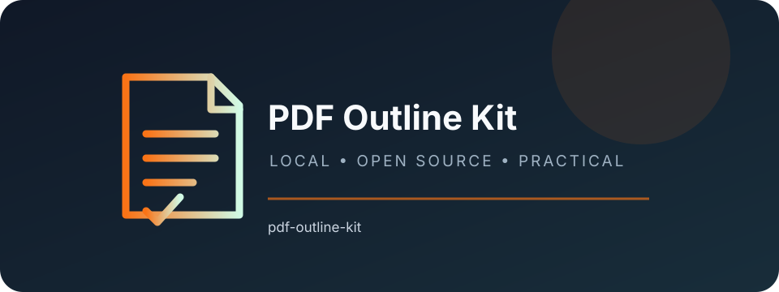

<p align="center"></p>
<p align="center"></p>
<p align="center">   </p>
<p align="center"></p>

## 🧭 Overview
PDF Outline Kit reads a local PDF's bookmark tree and exports it as Markdown or JSON. It is useful for checking document navigation and creating a portable outline without uploading the file.

## ✨ Features
- 📑 Preserves nested bookmark hierarchy.
- 🔢 Includes one-based page numbers when available.
- 🧾 Exports Markdown or JSON for documentation workflows.
- 🔒 Processes files locally and never modifies the source PDF.

## 🎬 Demo
```text
$ python main.py handbook.pdf --format markdown
# Handbook
- Getting started (p. 1)
  - Installation (p. 4)
```
This is a local example, not a hosted demo.

## 🚀 Quick Start
```bash
python -m pip install -r requirements.txt
python main.py handbook.pdf --format markdown
```
Some PDFs contain no outline, and some bookmarks point to destinations without a resolvable page. Those entries are reported with a null page.

## 🧰 Tech Stack
- Python 3.10+
- pypdf for PDF outline reading
- unittest

## 🗂️ Folder Structure
```text
main.py
pdf_outline.py
tests/test_pdf_outline.py
requirements.txt
assets/overview.svg
```

## 🗺️ Roadmap
- [x] Core local workflow
- [x] Documented command-line or browser interface
- [ ] Broader edge-case coverage
- [ ] Optional CI examples

## 🤝 Contributing
Issues and focused pull requests are welcome. Add regression tests for bug fixes and document new options.

## 📄 License
Released under the [MIT License](LICENSE).

<p align="center"></p>
